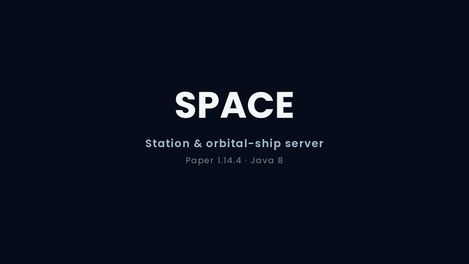

<h1 align="center">SPACE</h1>

<p align="center"><strong>Space Game Server</strong> — a 2019 Spigot/Paper 1.14.4 sandbox of orbital ships, stations, jobs, weapon systems and proximity voice.</p>

<p align="center">
  <a href="#tech-stack"></a>
  <a href="#overview"></a>
  <a href="#build"></a>
  <a href="#overview"></a>
  <a href="#license"></a>
  <a href="#status"></a>
</p>

<p align="center">
  <a href="#trailer">Trailer</a> ·
  <a href="#overview">Overview</a> ·
  <a href="#features">Features</a> ·
  <a href="#quick-start">Quick start</a> ·
  <a href="#project-layout">Layout</a> ·
  <a href="#status">Status</a> ·
  <a href="#license">License</a>
</p>

## Trailer



<p align="center"><sub>16 seconds · 1280×720 · <a href="media/space-trailer-still.png">still frame</a></sub></p>

> [!IMPORTANT]
> **Partial source release (PSR).** This is a cleaned and merged portfolio build, not a
> drop-in server. Most game data files, the schematics, map images and the database schema
> are not included. Systems that existed only on the live server — the inter-station market
> first among them — are described as design-only in the sections below.

## Contents

- [Overview](#overview)
  - [Systems](#systems)
  - [Tech stack](#tech-stack)
- [Features](#features)
  - [World generation](#world-generation)
  - [Ships and spatial allocation](#ships-and-spatial-allocation)
  - [Trigonometry: four right angles](#trigonometry-four-right-angles)
  - [Powers: five systems solved as geometry](#powers-five-systems-solved-as-geometry)
  - [Voice: a relay, not a mod](#voice-a-relay-not-a-mod)
  - [Custom textures](#custom-textures)
  - [Jobs and fabrication](#jobs-and-fabrication)
  - [Economy: a local index](#economy-a-local-index)
- [Quick start](#quick-start)
  - [Build](#build)
  - [Server setup](#server-setup)
  - [Required assets](#required-assets-not-shipped)
  - [Voice relay](#voice-relay)
- [Project layout](#project-layout)
- [Status](#status)
- [License](#license)

## Overview

`Space` is a Spigot/Paper **1.14.4** plugin for a space-station sandbox. It was created in
**2019** and is published here as a portfolio release: a cleaned, merged and partially
reconstructed build of the original server.

The plugin covers orbital ships and their spatial allocation, station data and property
rent, five job roles, weapon/power combat, resource-pack presentation and a TCP
proximity-voice bridge. The inter-station market and several live-server data sets were not
part of the source that survived; they are described as design-only rather than claimed as
shipped features.

| Item | Value |
|---|---|
| Plugin name | `Space` |
| Artifact | `fr.edouwarden:space-gameserver:1.0.0` |
| Created | **2019** |
| Java | 8 |
| Server | Spigot/Paper 1.14.4 |
| License | All rights reserved — portfolio review only (see [LICENSE](LICENSE)) |
| Author | edouwarden |

### Systems

| System | What it covers |
|---|---|
| [World generation](#world-generation) | Custom `space` and `exoplanet` dimensions from seeded simplex height fields. |
| [Ships and spatial allocation](#ships-and-spatial-allocation) | Schematic pasting onto a fixed orbital grid, WorldGuard regions and chart-based voyages. |
| [Trigonometry](#trigonometry-four-right-angles) | The four-angle rotation model used by ship corners and dock signs. |
| [Powers](#powers-five-systems-solved-as-geometry) | Five deterministic weapon systems built from closed-form geometry. |
| [Voice](#voice-a-relay-not-a-mod) | A Bukkit-to-Python TCP relay for proximity voice. |
| [Custom textures](#custom-textures) | Resource-pack delivery and the weapon presentation path. |
| [Jobs and fabrication](#jobs-and-fabrication) | Five job roles and an invisible-armor-stand fabrication bench. |
| [Economy](#economy-a-local-index) | A player-driven local price index, documented as a design. |

### Tech stack

| Layer | Stack |
|---|---|
| Runtime | Java 8 · Spigot/Paper 1.14.4 |
| Build | Maven · shaded `Space.jar` |
| Server APIs | WorldEdit 7 · WorldGuard 7 · AuthMe · ProtocolLib · EffectLib · Vault · SmartInvs · LibsDisguises |
| Voice | Python 3 TCP relay (`voice/`) |
| Media | Python 3 + Pillow · ffmpeg H.264 |

## Features

Each feature below is self-contained: what it does, how it works, and what this release
actually contains. The demo clips are intended to be hosted as GitHub attachments; the
marked placeholders show where each one goes.

### World generation

**What it does.** `world/SpaceWorlds` registers the `space` and `exoplanet` dimensions
with a custom chunk generator. The worlds are persisted and never deleted, so stations,
ships and player builds survive a restart. Terrain is deterministic: the same seed always
produces the same height field.

**How it works.** Heights come from Bukkit's `SimplexOctaveGenerator` with seed
`4701234567L`, scale `0.008`, six octaves and ×12 amplitude. That field spans 47–80; the
shipped height bands and material rules turn it into the final surface. A column starts
with bedrock at `y=0`, then end stone over four blocks of andesite/gravel, with iron at
1/220 and coal at 1/140. The height-field render uses values dumped from the same
generator; projection, light and the cut-away are the only additions. Sample columns of
the 320×320 grid were checked block-for-block against the running server: `(0,0)=70`,
`(8,8)=65`, `(−8,−8)=73`.

**Scope.** The flat dirt floor and the per-column material rolls are teaching steps, not
the shipped generator.


https://github.com/user-attachments/assets/02c80d39-99a9-4930-92f9-2aa4f111b2d8

### Ships and spatial allocation

**What it does.** Ships are pasted from `.schem` files onto a fixed grid in the `space`
world. Each vessel gets a WorldGuard region and an undo region, so it can be protected,
boarded, mapped, parked and removed cleanly. A voyage moves a ship icon across a chart
rather than moving the ship through world space.

**How it works.** Allocation starts at `(1195, −1081)` and steps 75 blocks in x and z
across 11 × 11 slots. The code scans for a gold marker at `y = 81`, pastes the cage and the
hull, and teleports the player to `y = 61`. `ShipEntity.movetoSpace` advances the voyage
with `vlocX += speed·sin(vrot)` and `vlocZ += speed·cos(vrot)` on the 99 × 99
`frontier.yml` chart at 5 seconds per cell. On arrival, `endTravel` picks the nearest
station slot, teleports the crew, removes the ship and pastes it at the station.

**Scope.** The release ships no schematics, so the hull inside the black shell is not
shown. The cabin, shell, chart and station views are reconstructions drawn from the
shipped `SpaceSession` constants and are labelled as such.


https://github.com/user-attachments/assets/696fbea8-52d2-46c4-810e-fe2739559daa


### Trigonometry: four right angles

**What it does.** Ship corners and dock signs do not use a free heading. Rotation is
resolved through four right-angle branches, which keeps the hull aligned to the grid and
the sign facing one of four directions.

**How it works.** `SpawnSign.rotation` maps `EAST → 0`, `WEST → 180`, `NORTH → 90` and
every other facing to `270`. `extremePoint` then rotates a corner offset with four
branches — `90° → (−z, x)`, `0° → (−x, −z)`, `270° → (z, −x)`, and `180°` falling through
to `(x, z)`. That is the 2×2 rotation matrix at right angles, written out by hand.

**Scope.** A separate, general rotation (`PlayerKO.rotateAroundAxisY`) is private and
uncalled: it negates the angle before the cos/sin pair, the two negations cancel to the
standard matrix, but the hull path never leaves the four right angles. The release has no
schematics, so the hulls are diagrams; every branch, angle and constant is read from the
shipped source, and the diagrams show geometry only, not source lines.


https://github.com/user-attachments/assets/35739d73-2a8b-4323-b782-9a5e2c0cc647

### Powers: five systems solved as geometry

**What it does.** Five weapon systems are resolved as deterministic geometry: a plasma
array, a graviton press, an arc lance, a fracture charge and a seismic driver. Every point
comes from a closed-form expression in the shared `power/WeaponFx` helper, so a cast looks
the same on every tick and on every client.

**How it works.** There is no `Math.random` and no engine call inside the geometry. Each
system has its own closed form, and damage falls off with distance: linear for the plasma
array, exponential for the arc lance and the seismic driver, and a `cos θ` envelope for the
fracture charge; the graviton press uses its own height-to-radius relation.

| id | system | behaviour | geometry |
|---|---|---|---|
| `flame` | Plasma Array | three interleaved helical filaments advance along the aim axis | `r(θ,t)=r₀+βt`, `x=r cos θ`, `z=r sin θ`, `y=v t` |
| `weight` | Graviton Press | an anvil released from nine blocks lands on the deck prop | `E=mgh`, `rₛ=k√h`, `D=D₀h/(rₛ²+1)` |
| `volt` | Arc Lance | the charge hops between three sentinel golems, weakening per link | `V(d)=V₀e^(−λd)`, `I=V/R` |
| `bomb` | Fracture Charge | the charge arcs to a point and breaks into a forward cone | `N(θ)=N₀cos²θ`, `D(θ)=D₀cos θ` |
| `quake` | Seismic Driver | one particle ring crosses the deck | `y(r,t)=A sin(kr−ωt)e^(−r/κ)` |

The same constants drive the damage curve for each system. **Scope.** The registry also
contains ten older powers. They keep their original behaviour, are not rewritten as
closed-form geometry and are outside this write-up. The five systems are shown as in-game
captures on Paper 1.14.4.

https://github.com/user-attachments/assets/5b977d1f-95c3-48ee-8955-0ac6490ec362 

### Voice: a relay, not a mod

**What it does.** Proximity voice runs beside Paper instead of inside it. Bukkit has no
audio API, so the plugin opens a plain TCP socket to a separate Python relay, writes one
routing line and closes the connection. Audio travels on different sockets and never enters
the server.

**How it works.** The control line is `&speaker&target#volume&target#volume`. The relay keys
every client by IP, because the plugin knows the Minecraft connection address but not the
source port the voice client opens. One voice client is allowed per IP; a second connection
replaces the first (`previous.close()`). Volume is linear in distance:
`clamp((1 − d/range) × 100, 0, 100)`, applied by multiplying the int16 samples in the
relay. The lever cycles mute 0, low 3, normal 9 and high 15 blocks.

**Scope.** The Python pair in [`voice/`](voice/) is optional and is not a mod. The test
harness uses two addresses so the relay does not merge both clients: `Dev` on
`127.0.0.1`, and `Caster` in a `spacev` network namespace at `10.200.0.2`, reaching the
server and relay through TCP proxies. That harness is not part of the release. The VM has
no microphone, so the audio measurement sends a synthetic 440 Hz tone through the real
relay: routing `#81` delivered 81.0% of the input peak, routing `#9` delivered 9.0%. Run
one client per public IP address.

https://github.com/user-attachments/assets/dd59d691-27ae-43d0-a665-d194c41becca 

### Custom textures

**What it does.** The plugin can hand players a resource pack at login and uses item
metadata to present weapons with custom names, stats and tooltips. The gameplay item stays
a normal server-side item; the pack only changes how it looks.

**How it works.** `Join` calls `player.setResourcePack(path)` after AuthMe login, and
`ResourcePackStatus` kicks the player on `DECLINED`. A weapon is a `WOODEN_SWORD` whose
seven stats live in `setLocalizedName`; the display name is rewritten, the item is made
unbreakable and the tooltip flags are hidden.

**Scope.** The release has no `pack.mcmeta`, no model JSON and no textures, and **no
`CustomModelData` assignment**, so the intended pack tree and the three variants are a
labelled reconstruction, not recovered assets. The config default `resource-pack.url` is
empty, so the prompt is skipped on a fresh install.

https://github.com/user-attachments/assets/fdbf568d-d02e-4699-9974-02a5cd4ea7cf

### Jobs and fabrication

**What it does.** The jobs module defines five roles — `FABRICATOR`, `NUTRIENT`,
`SENTINEL`, `ASTROGATOR` and `STATIONMASTER` — and adds a fabrication bench that turns two
inputs into a named item. The bench is a normal block with a custom interaction, not a
vanilla anvil menu.

**How it works.** `Craft.setup()` reads `materials.yml`. For an `Anvil` entry it builds a
two-input recipe and registers it with `AnvilCraft`; the shipped file contains one recipe:
oak log + iron ingot → **Plasma Cutter**. The two ingredients are displayed by invisible
armor stands offset to `x+0.25` and `x+0.75`, `y+0.8`, `z+0.3`, so both stay visible. A
stick named `Fabrication Hammer` is the only trigger; the vanilla anvil GUI is suppressed
and closed on the next tick. The lookup matches either input order and returns the recipe
output, which lands in the first empty hotbar slot.

**Scope.** `materials.yml` ships this one example recipe. The other job data files are
absent, so job progression and payouts are not demonstrated. The bench itself is exercised
in-game on Paper 1.14.4.


https://github.com/user-attachments/assets/7ef72ac5-97d3-4be5-8772-9915a4247377

### Economy: a local index

**What it does.** The economy design is built around a local index `P`, set by player
offers and demand rather than a fixed server price. Forest worlds have abundant wood, so
`P` is low there; non-forest worlds need wood and price it high, which makes travel worth
the risk. The intended loop runs from cutting wood on a forest world, through the choice
between the automatic market and player listings, to a world where wood is scarce, a
fabrication step and a return to the galaxy map.

**How it works.** The automatic market is always available but quotes `0.8 × P` when it
buys and `1.2 × P` when it sells; the 20% spread is its fee. Player-to-player listings sit
at `P`, so both sides get the better price if they wait for a counterparty.

**Scope.** The whole market loop — local indices, the automatic spread, the P2P order
book, travel time and the crafting progression — **is design only**. No market, stock,
price or trade module exists in 1.0.0. The design is badged `design · not implemented`
wherever it is presented, prices are a relative 0–100 index rather than server values, and
travel times are design parameters.

What *is* shipped is separate and smaller: five station constants, `Property.pay` through
Vault and a rent cap of 20 days. The tax/duty loop does not run — `addTaxesFund` and
`addDutyFund` have no callers, `Property.pay` never calls the station, and `MayorGUI` calls
only `payOwnerDuty()`. Even if wired, `char / 100` is integer division, so a rate below 100
truncates to zero. That part is badged `shipped · limited`; it is not the market in the
design.


https://github.com/user-attachments/assets/2d9f4d85-7c6b-4ef9-9e9a-8d913f58fd18

## Quick start

### Build

```bash
mvn -B package
```

The shaded jar is written to `target/Space.jar`. Maven resolves Spigot, WorldEdit 7,
WorldGuard 7, ProtocolLib, AuthMe, EffectLib, LibsDisguises, SmartInvs and VaultAPI from
their public repositories. The `particle` dependency was removed in 1.0.0, so the jar
carries the plugin classes and no relocatable third-party particle stack.

### Server setup

Install these plugins on the server before `Space`:

- WorldEdit 7.0.x and WorldGuard 7.0.x
- AuthMe 5.6.x
- ProtocolLib 4.5.x
- EffectLib 9.4
- Vault (with an economy provider)
- SmartInvs 1.2.7
- LibsDisguises 10.0.x

Then copy `target/Space.jar` into `plugins/` and start the server once to generate
`plugins/Space/config.yml`. Configure the database and voice sections there, or set the
`SPACE_DB_*` environment variables (see `variables/DatabaseConfig`).

### Required assets (not shipped)

The source expects these files in `plugins/Space/`:

- `schematics/ship-<n>.schem` and `schematics/ship-<n>-reset.schem`
- `foodDatas.yml`, `propertys.yml`, `stations.yml`, `WorldMaps/frontier.yml`

`materials.yml` ships with one example fabrication recipe (oak log + iron ingot →
Plasma Cutter). The plugin creates the remaining YAML files empty on first start, so
gameplay that reads those definitions (food, properties, stations) stays inert until they
are filled in. The database schema for the ship tables is likewise not included.

### Voice relay

The Python pair in [`voice/`](voice/) is optional. It is a plain TCP relay: the plugin
sends routing lines (`&speaker&target#volume`) on the control port, and clients exchange
raw int16 audio on the audio port. Clients are keyed by IP, so run one client per public
IP address.

```bash
cd voice
python3 -m pip install -r requirements.txt
python3 server.py --host 0.0.0.0 --audio-port 5000 --control-port 81
python3 client.py --host <relay-host> --port 5000
```

The Java side reads `voice.host`, `voice.audio-port` and `voice.control-port` from
`config.yml`.

## Project layout

```text
space-gameserver-2019-psr/
  pom.xml
  README.md
  media/                  poster stills and the repository trailer
    space-trailer.gif     repository trailer (title + world generation + four plates)
    space-trailer-still.png  the three-seed planet plate
    *-demo-still.png      one poster per feature
  src/main/java/fr/edouwarden/space/
    commands/     /space subcommands
    data/         player and map persistence
    event/        Bukkit event listeners
    fight/        damage and weapons
    gui/          SmartInvs menus
    jobs/         jobs and job actions
    key/          item key helpers
    mysql/        optional ship storage helpers
    other/        stations and raids
    player/       per-player state
    power/        power registry and abilities
    resources/    WorldEdit/WorldGuard helpers, chunk generator
    ship/         ship entities and signs
    sign/         sign parsing
    station/      stations and properties
    variables/    runtime configuration
    voice/        proximity-voice bridge
    voyage/       space sessions
    web/          optional servlet endpoint
    world/        generated space dimensions
    Loop.java     main repeating task
  src/main/resources/
    plugin.yml
    config.yml
    materials.yml         one example fabrication recipe
  voice/
    client.py
    server.py
    requirements.txt
```

## Status

| In this tree | Not in this tree |
|---|---|
| Maven build and shaded `Space.jar` | Ship and station schematics |
| Plugin load and commands on Paper 1.14.4 | Map images and `frontier.yml` |
| `space` and `exoplanet` generation | Database schema |
| Fabrication bench with one recipe | Inter-station market (design only) |
| Five closed-form powers | Resource pack, models and textures |
| Voice relay code | Live-server game data |

Compiles cleanly with Maven on JDK 8. The plugin loads on Paper 1.14.4 (with the plugins
listed above), registers its commands and generates the `space` and `exoplanet`
dimensions — see the [features](#features). The fabrication bench and its shipped example
recipe are exercised in-game. Gameplay that depends on the missing assets and database
schema (stations, ships, properties, food) is untested. The station-to-space entry
(`SpaceSession.enter`) is ported but not wired to a sign or command in this partial
release. The scope table above and each feature's Scope paragraph record what was
deliberately left out.

## License

**Proprietary — all rights reserved.** This repository and its contents are published for
portfolio review only. No permission is granted to copy, modify, merge, publish,
distribute, deploy, sublicense, sell, use commercially or create derivative works from the
source code, documentation or media, in whole or in part, for any purpose. Viewing the
repository does not grant a license to reuse it. See [LICENSE](LICENSE) for the full terms.

Third-party libraries, APIs and game assets referenced by the build remain under their own
licenses and are not covered by this notice.

<p align="center"><sub>Created in 2019 · portfolio release 1.0.0 · © edouwarden</sub></p>
